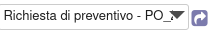
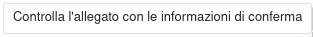

Entrare in un ordine di acquisto o di vendita con un allegato con la
conferma d'ordine (oppure aggiungerlo) e selezionarlo nel box:

Avviare il controllo con il bottone:

Per creare le righe dell'ordine di vendita dall'allegato, configurare una
connessione AI (vedi CONFIGURE) e usare il bottone *Create rows from
attachment*. Le procedure di estrazione del testo e di creazione delle righe
sono definite come record `ai.tool` e possono essere riutilizzate da altri
strumenti AI.
